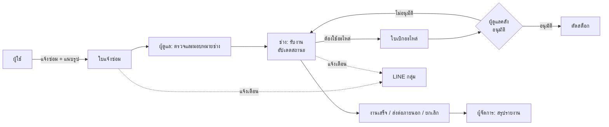

# FixDesk: Repair Request & Stock System (Case Study)

ระบบแจ้งซ่อมและจัดการอะไหล่ในองค์กร ผู้ใช้แจ้งซ่อมพร้อมแนบรูป ผู้ดูแลมอบหมายช่าง ช่างรับงานและอัปเดตสถานะ เบิกอะไหล่จากคลังผ่านการอนุมัติ ผู้จัดการดูสรุปผล และมีแจ้งเตือนเข้า LINE กลุ่มเมื่อมีงานใหม่หรือเปลี่ยนสถานะ

**สถานะ:** ลูกค้าใช้งานทดสอบอยู่ ผมดูแลการ deploy และแก้ปัญหาหลังลูกค้าใช้งาน และกำลังย้ายระบบพร้อมข้อมูลเดิมไปยังเซิร์ฟเวอร์ของเจ้าของระบบ
**ลักษณะงาน:** โปรเจกต์ทีม (ผู้ร่วมพัฒนากว่า 10 คน) นักศึกษาฝึกงานเป็นผู้พัฒนาระบบเดิมทั้งหมด ผมเข้ามาดูแลช่วงท้ายของโครงการ ตั้งแต่นำระบบขึ้น server ไปจนถึงดูแลหลังใช้งาน และย้ายระบบหลังบ้านไปรันบนโฮสติ้งของเจ้าของ โดยใช้ AI (Claude) ช่วยเขียนโค้ดส่วนที่ย้าย
**โค้ด:** อยู่ใน private repository ของทีม ยินดีอธิบายเชิงเทคนิคในการสัมภาษณ์

---

## ระบบทำงานอย่างไร

**บทบาทผู้ใช้:** ผู้แจ้ง, ผู้ดูแลระบบ, ผู้จัดการ, ช่าง, หัวหน้าช่าง, เจ้าหน้าที่คลัง (แต่ละบทบาทมีเมนูและสิทธิ์ต่างกัน)

| ส่วน | เทคโนโลยี |
|---|---|
| Frontend | Vue 3, Vite |
| Backend (เดิม) | Node.js, Express, JWT, MySQL |
| Backend (ย้ายใหม่) | Laravel 12 (PHP 8.2), JWT, MySQL |
| แจ้งเตือน | LINE Messaging API |
| Deploy ช่วงที่ผมดูแล | Docker Compose, nginx reverse proxy บน VPS |

---

## ส่วนที่ผมรับผิดชอบ

### 1. นำระบบขึ้น server และดูแลหลังใช้งานจริง
- ตั้งค่า Docker Compose สำหรับ production (frontend และ backend) ผ่าน nginx reverse proxy บน VPS พร้อมโดเมนและ HTTPS
- ดูแลระบบตอนลูกค้าใช้งาน แก้บั๊กและข้อผิดพลาดที่ลูกค้าพบ

### 2. ย้ายระบบหลังบ้านจาก Node.js ไปเป็น Laravel (PHP) โดยใช้ AI ช่วยเขียน
เจ้าของระบบให้ย้ายไปรันบนโฮสติ้งที่ทำได้แค่อัปโหลดไฟล์ ไม่มี command line หรือ SSH จึงใช้ Node.js ไม่ได้ ผมตัดสินใจย้ายเฉพาะ backend ไปเป็น Laravel และคง frontend เดิมไว้ โดยทำงานร่วมกับ AI (Claude) ซึ่งเป็นผู้เขียนโค้ด Laravel ส่วนใหญ่ ผมเป็นผู้กำหนดโจทย์ ข้อจำกัด และตรวจรับ

**ผมรับผิดชอบ:**
- **กำหนดสถาปัตยกรรมและข้อจำกัด:** เลือก Laravel เพราะเหมาะกับ shared hosting และกำหนดให้ **คง API contract เดิมทุกจุด** (path รูปแบบข้อมูลที่ตอบกลับ URL ไฟล์อัปโหลด) เพื่อให้ frontend ใช้งานต่อได้ โดยแก้ไข frontend เพียงเล็กน้อย (ไฟล์เรียก API หนึ่งไฟล์และไฟล์ตั้งค่า)
- **ตรวจรับงานที่ AI เขียน:** เทียบ route และผลลัพธ์กับระบบเดิม (Laravel 72 route เทียบกับ Node 74 route) ทั้งกลุ่มล็อกอิน แจ้งซ่อม ช่าง คลังและเบิกอะไหล่ สถานที่ ผู้ใช้ และแม่แบบ ทดสอบบนเครื่องก่อนส่งมอบ
- **เตรียมชุดส่งมอบสำหรับโฮสติ้งที่ไม่มี command line:** แยกโฟลเดอร์ `public_html` กับโค้ดแอป ตั้งค่า `.htaccess` และ `.user.ini` ให้รับอัปโหลดรูปแจ้งซ่อมได้หลายไฟล์ และมี `schema.sql` สำหรับนำเข้าฐานข้อมูลแทนการรัน migration
- **เตรียมย้ายข้อมูลเดิม** จากเซิร์ฟเวอร์เก่าไปเซิร์ฟเวอร์ใหม่ เพื่อให้ลูกค้าทำงานต่อได้ทันที (อยู่ระหว่างดำเนินการ)

**ผลที่ได้:** โครงสร้างแบบแยก layer (Controller → Service) เหมือนของเดิม ระบบล็อกอิน JWT ที่เข้ากันได้ ฐานข้อมูล 15 ตารางผ่าน migration และ service สำหรับแจ้งเตือน LINE กับอัปโหลดไฟล์

---

## ปัญหาที่ท้าทายและวิธีแก้

### 1. ย้าย backend โดยไม่แตะ frontend
ต้องส่งมอบให้ทัน จึงให้ API ใหม่ตอบเหมือนเดิมทุกจุด รวมจุดเล็กๆ เช่น URL ที่ใช้แสดงรูปที่อัปโหลด แล้วเทียบกับระบบเดิมก่อนสลับใช้งาน

### 2. ข้อจำกัดของ shared hosting
ไม่มี command line ทำให้รัน `composer install`, `migrate` หรือ build ไม่ได้ ต้องเตรียมทุกอย่างให้พร้อมก่อนอัปโหลด ทั้งไฟล์ dependency โครงสร้างโฟลเดอร์ และ SQL สำหรับสร้างฐานข้อมูล รวมถึงตั้งค่าขนาดไฟล์อัปโหลดผ่าน `.user.ini`

### 3. เว็บไม่สามารถเข้าถึงได้หลังผู้ให้บริการ VPS รีบูตเครื่อง
**อาการ:** เว็บเปิดไม่ได้ ขึ้น 502 หลังผู้ให้บริการ VPS รีบูตเครื่องเพื่อแพตช์ช่องโหว่ **สาเหตุ:** nginx ไม่ได้ตั้งให้เริ่มตอนบูต และคอนเทนเนอร์บางตัวไม่มี restart policy **วิธีแก้:** เปิด nginx พร้อม `systemctl enable` และเพิ่ม `restart: unless-stopped` ให้ทุก service

### 4. คำสั่ง deploy ผิดไฟล์ทำให้ระบบหลักถูกแทนที่ชั่วคราว
ระหว่างสร้างคอนเทนเนอร์ใหม่ ใช้ไฟล์ compose ของโหมด dev ที่ชื่อ service ซ้ำกับของ production ทำให้คอนเทนเนอร์ production ถูกแทนที่ด้วยตัว dev ชั่วคราว (502) แก้โดยระบุไฟล์ production และใช้ `--no-deps` ทุกครั้ง และเอาคอนเทนเนอร์ dev ที่เปิดพอร์ตสู่ภายนอกออก

### 5. ตารางข้อมูลกดหน้าถัดไปไม่ได้
ตารางในหน้าจัดการรายงานแบ่งหน้าซ้ำสองชั้น (หน้าจอส่งเฉพาะแถวของหน้าปัจจุบันให้ตารางที่แบ่งหน้าเองอีกครั้ง) ทำให้เห็นข้อมูลแค่หน้าเดียว แก้ให้ส่งแถวที่ผ่านตัวกรองทั้งหมดและให้ตารางแบ่งหน้าเอง

### 6. `renderStatusBadge is not a function`
หน้าเว็บ production error หลัง pull โค้ดใหม่ ตรวจสอบประวัติ git จนพบว่าการวางคอมเมนต์ในคอมมิตหนึ่งลบฟังก์ชันแสดงป้ายสถานะออกไปจากคอมโพเนนต์ตาราง จึงกู้ฟังก์ชันจากคอมมิตก่อนหน้า ตรวจไวยากรณ์ และ build ใหม่ แล้วแจ้งทีมต้นทาง

---

## สิ่งที่ได้เรียนรู้
- ดูแลระบบจริงหลังส่งมอบ: ตรวจสอบปัญหาจากชั้นนอกเข้าสู่ชั้นใน (เครือข่าย → nginx → คอนเทนเนอร์ → โค้ด)
- ใช้ Git สืบหาสาเหตุของข้อผิดพลาดจากประวัติ และใช้ cherry-pick / revert อย่างปลอดภัย
- ย้ายสถาปัตยกรรม backend ข้ามภาษาโดยรักษา API เดิม และทำงานร่วมกับ AI ช่วยเขียนโค้ด โดยคนเป็นผู้กำหนดข้อจำกัด ตรวจรับ และรับผิดชอบผลลัพธ์
- ทำงานภายใต้ข้อจำกัดของโฮสติ้ง (ไม่มี command line) และเตรียมชุดส่งมอบให้ลูกค้าติดตั้งได้เอง
- ส่งต่องานเมื่อต้องออกจากทีม

## ขั้นต่อไปที่วางแผน
- เขียน automated test ของ API ที่ย้ายมา